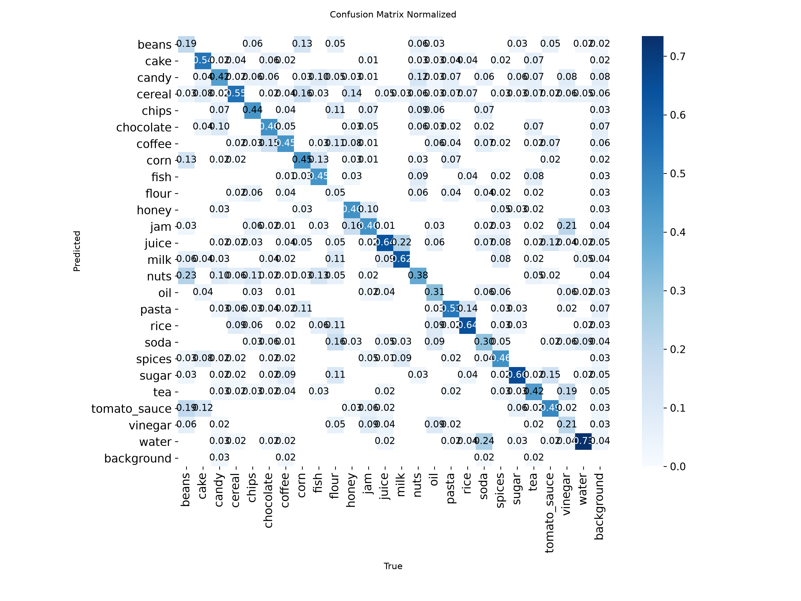
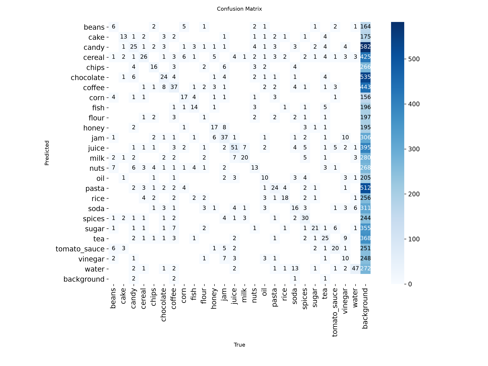

# Evaluation: grocereye_p6k (2026-10-27)

- Weights: `models/grocereye_p6k/best.pt`
- Data: `data/grocereye/data.yaml`, split `test` (495 images, 1152 labeled boxes)
- imgsz 320, stage A

## Dataset split

- Source: archive master.zip
- Method: stratified by class 80/10/10 train/val/test, seed 0
- Images: train 3957, val 495, test 495
- split.json: `data/grocereye/split.json` (created 2026-10-06T15:54:43+00:00)

## Summary

| metric | value | target / baseline | status |
|---|---|---|---|
| mAP50 | 0.9238 | GrocerEye 0.8459 | beats baseline (+7.79 pts) |
| mAP50 (NFR-5) | 0.9238 | >= 0.85 | PASS |
| mAP50-95 | 0.7954 | - | - |

GrocerEye's 84.59% is Darknet mAP@0.5 on its own (unpublished) random 20% test split, so the comparison is approximate.

## Per-class results

Ultralytics P/R are at the max-F1 confidence; operating-point P/R are at conf 0.50, IoU >= 0.5.

| class | images | boxes | AP50 | AP50-95 | P (val) | R (val) | P @op | R @op | TP | FP | FN |
|---|---|---|---|---|---|---|---|---|---|---|---|
| beans | 14 | 31 | 0.941 | 0.857 | 0.892 | 0.903 | 0.862 | 0.806 | 25 | 4 | 6 |
| cake | 16 | 24 | 0.963 | 0.891 | 0.787 | 0.926 | 0.767 | 0.958 | 23 | 7 | 1 |
| candy | 37 | 60 | 0.869 | 0.696 | 0.876 | 0.733 | 0.824 | 0.700 | 42 | 9 | 18 |
| cereal | 28 | 47 | 0.976 | 0.840 | 0.884 | 0.936 | 0.776 | 0.957 | 45 | 13 | 2 |
| chips | 18 | 36 | 0.985 | 0.826 | 0.971 | 0.944 | 0.868 | 0.917 | 33 | 5 | 3 |
| chocolate | 31 | 52 | 0.924 | 0.721 | 0.896 | 0.828 | 0.849 | 0.865 | 45 | 8 | 7 |
| coffee | 30 | 82 | 0.907 | 0.802 | 0.915 | 0.790 | 0.833 | 0.854 | 70 | 14 | 12 |
| corn | 10 | 38 | 0.976 | 0.900 | 0.875 | 1.000 | 0.771 | 0.974 | 37 | 11 | 1 |
| fish | 11 | 31 | 0.944 | 0.832 | 0.887 | 0.903 | 0.794 | 0.871 | 27 | 7 | 4 |
| flour | 11 | 19 | 0.715 | 0.569 | 0.904 | 0.498 | 0.800 | 0.421 | 8 | 2 | 11 |
| honey | 18 | 37 | 0.965 | 0.837 | 0.748 | 0.946 | 0.679 | 0.973 | 36 | 17 | 1 |
| jam | 24 | 81 | 0.985 | 0.880 | 0.933 | 0.963 | 0.849 | 0.975 | 79 | 14 | 2 |
| juice | 30 | 80 | 0.966 | 0.888 | 0.892 | 0.933 | 0.824 | 0.938 | 75 | 16 | 5 |
| milk | 16 | 32 | 0.994 | 0.850 | 0.939 | 1.000 | 0.821 | 1.000 | 32 | 7 | 0 |
| nuts | 17 | 34 | 0.893 | 0.710 | 0.873 | 0.810 | 0.812 | 0.765 | 26 | 6 | 8 |
| oil | 14 | 32 | 0.922 | 0.802 | 0.928 | 0.801 | 0.800 | 0.875 | 28 | 7 | 4 |
| pasta | 17 | 45 | 0.888 | 0.700 | 0.852 | 0.768 | 0.825 | 0.733 | 33 | 7 | 12 |
| rice | 15 | 28 | 0.851 | 0.777 | 0.765 | 0.821 | 0.667 | 0.857 | 24 | 12 | 4 |
| soda | 18 | 54 | 0.824 | 0.657 | 0.856 | 0.815 | 0.815 | 0.815 | 44 | 10 | 10 |
| spices | 21 | 65 | 0.967 | 0.849 | 0.908 | 0.913 | 0.792 | 0.877 | 57 | 15 | 8 |
| sugar | 12 | 32 | 0.902 | 0.723 | 0.780 | 0.844 | 0.659 | 0.844 | 27 | 14 | 5 |
| tea | 28 | 59 | 0.890 | 0.778 | 0.854 | 0.797 | 0.793 | 0.780 | 46 | 12 | 13 |
| tomato_sauce | 17 | 41 | 0.966 | 0.872 | 0.847 | 0.976 | 0.736 | 0.951 | 39 | 14 | 2 |
| vinegar | 16 | 48 | 0.897 | 0.744 | 0.830 | 0.938 | 0.737 | 0.875 | 42 | 15 | 6 |
| water | 26 | 64 | 0.988 | 0.886 | 0.897 | 0.984 | 0.873 | 0.969 | 62 | 9 | 2 |

## Confusion matrix (conf 0.50, IoU >= 0.5, rows = true class)

| true \ pred | beans | cake | candy | cereal | chips | chocolate | coffee | corn | fish | flour | honey | jam | juice | milk | nuts | oil | pasta | rice | soda | spices | sugar | tea | tomato_sauce | vinegar | water | background |
|---|---|---|---|---|---|---|---|---|---|---|---|---|---|---|---|---|---|---|---|---|---|---|---|---|---|---|
| beans | **25** | . | . | . | . | . | . | 1 | . | . | . | . | . | . | . | . | . | . | . | . | . | . | 2 | . | . | 3 |
| cake | . | **23** | . | . | . | . | . | . | . | . | . | . | . | . | . | . | . | . | . | . | . | . | . | . | . | 1 |
| candy | . | . | **42** | . | . | 2 | . | . | . | . | . | . | . | . | . | . | . | . | . | . | . | 1 | . | . | . | 15 |
| cereal | . | . | . | **45** | . | . | . | . | . | . | . | . | . | . | . | . | . | . | . | . | . | . | . | . | . | 2 |
| chips | . | . | . | . | **33** | . | . | . | . | . | . | . | . | . | . | . | . | . | . | . | . | . | . | . | . | 3 |
| chocolate | . | . | . | . | . | **45** | . | . | . | . | . | . | . | . | . | . | . | . | . | . | 1 | . | . | . | . | 6 |
| coffee | . | . | . | . | . | . | **70** | . | . | . | . | . | . | . | . | . | . | . | . | . | . | 1 | . | . | . | 11 |
| corn | . | . | . | . | . | . | . | **37** | . | . | . | . | . | . | . | . | . | . | . | . | . | . | . | . | . | 1 |
| fish | . | . | . | . | . | . | . | . | **27** | . | . | . | . | . | . | . | . | . | . | . | . | . | . | . | . | 4 |
| flour | . | . | . | . | . | . | . | . | 1 | **8** | . | . | 1 | . | . | . | . | 1 | . | 1 | . | . | . | . | . | 7 |
| honey | . | . | . | . | . | . | . | . | . | . | **36** | . | . | . | . | . | . | . | . | . | . | . | . | . | . | 1 |
| jam | . | . | . | . | . | . | . | . | . | . | 1 | **79** | . | . | . | . | . | . | . | . | . | . | . | . | . | 1 |
| juice | . | . | . | . | . | . | . | . | . | . | . | . | **75** | . | . | . | . | . | 3 | . | . | . | . | . | . | 2 |
| milk | . | . | . | . | . | . | . | . | . | . | . | . | . | **32** | . | . | . | . | . | . | . | . | . | . | . | . |
| nuts | . | . | 1 | . | . | . | . | . | . | . | . | . | 1 | . | **26** | . | . | . | . | . | . | . | . | . | . | 6 |
| oil | . | . | . | . | . | . | . | . | . | . | . | . | . | . | . | **25** | . | . | . | . | . | . | . | 5 | . | 2 |
| pasta | . | . | . | 2 | . | . | . | . | . | . | . | . | . | . | . | . | **33** | . | . | . | . | . | . | . | . | 10 |
| rice | . | . | . | . | . | . | . | . | . | . | . | . | . | . | . | . | . | **24** | . | . | . | . | . | . | . | 4 |
| soda | . | . | . | . | . | . | . | . | . | . | . | . | . | . | . | . | . | . | **44** | . | . | . | . | . | 2 | 8 |
| spices | . | . | . | . | . | . | . | . | . | . | . | . | . | 1 | . | . | . | 3 | . | **56** | . | . | . | . | . | 5 |
| sugar | . | . | . | . | . | . | . | . | . | . | . | . | 2 | . | . | . | . | . | . | . | **27** | 1 | . | . | . | 2 |
| tea | . | 1 | . | . | . | . | . | . | . | . | . | . | . | . | . | . | . | . | . | . | . | **46** | . | . | . | 12 |
| tomato_sauce | . | . | . | . | . | . | . | . | . | . | . | . | . | . | . | . | . | . | 1 | . | . | . | **39** | . | . | 1 |
| vinegar | . | . | . | . | . | . | . | . | . | . | . | . | . | . | . | 2 | . | . | . | . | . | . | . | **42** | 2 | 2 |
| water | . | . | . | . | . | . | . | . | . | . | . | . | . | . | . | . | . | . | . | . | . | . | . | 1 | **62** | 1 |
| background | 4 | 6 | 8 | 11 | 5 | 6 | 14 | 10 | 6 | 2 | 16 | 14 | 12 | 6 | 6 | 8 | 7 | 8 | 6 | 15 | 13 | 9 | 12 | 9 | 5 | . |

Ultralytics confusion-matrix PNGs are computed at its val conf (0.001), so they show more low-confidence detections than the table above.

## Speed (ms per image, this machine)

preprocess 0.7, inference 1.6, loss 0.0, postprocess 1.7
