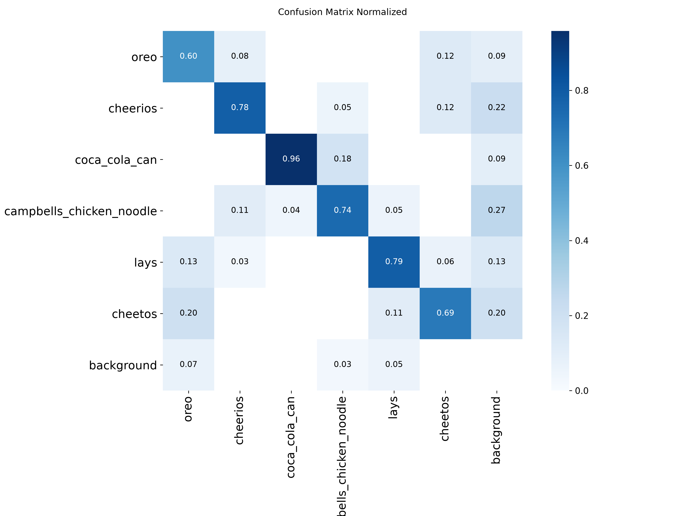
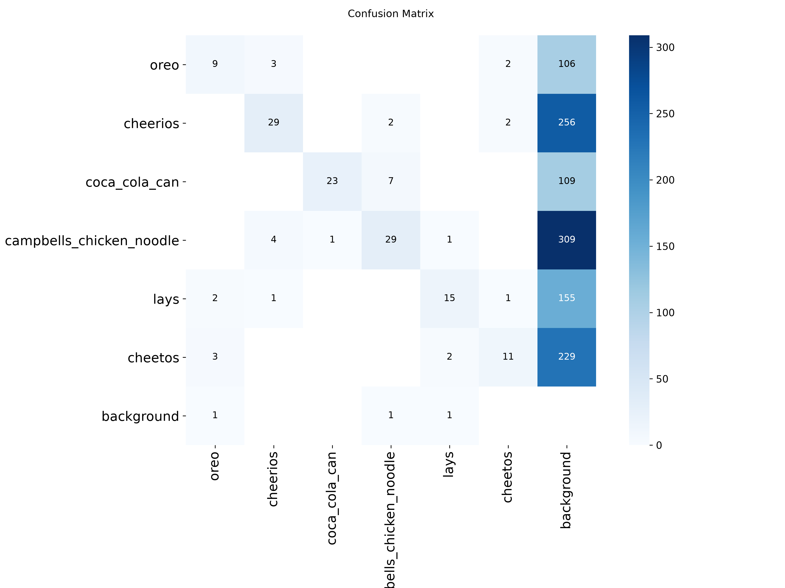

# Evaluation: snacks_yolo11n_test (2026-10-29)

- Weights: `models/snacks_yolo11n.pt`
- Data: `C:/Users/orepo/Documents/boulder/GEEN1400 Fall 2026/VisuallyImpairedBodycam/../model/snacks_dataset/data.yaml`, split `test` (79 images, 150 labeled boxes)
- imgsz 640, stage B

## Dataset split

- split.json not found; split unknown.

## Summary

| metric | value | target / baseline | status |
|---|---|---|---|
| mAP50 | 0.8883 | GrocerEye 0.8459 | beats baseline (+4.24 pts) |
| mAP50-95 | 0.7860 | - | - |
| NFR-6 per-class P >= 0.90, R >= 0.80 at conf 0.50 | 1/6 classes | all | FAIL |

GrocerEye's 84.59% is Darknet mAP@0.5 on its own (unpublished) random 20% test split, so the comparison is approximate.

### Classes below NFR-6

- oreo: precision 0.69 < 0.90, recall 0.60 < 0.80
- cheerios: recall 0.68 < 0.80
- campbells_chicken_noodle: precision 0.88 < 0.90, recall 0.72 < 0.80
- lays: precision 0.83 < 0.90, recall 0.79 < 0.80
- cheetos: precision 0.88 < 0.90

## Per-class results

Ultralytics P/R are at the max-F1 confidence; operating-point P/R are at conf 0.50, IoU >= 0.5.

| class | images | boxes | AP50 | AP50-95 | P (val) | R (val) | P @op | R @op | TP | FP | FN |
|---|---|---|---|---|---|---|---|---|---|---|---|
| oreo | 9 | 15 | 0.749 | 0.641 | 0.618 | 0.755 | 0.692 | 0.600 | 9 | 4 | 6 |
| cheerios | 12 | 37 | 0.910 | 0.779 | 0.870 | 0.838 | 0.926 | 0.676 | 25 | 2 | 12 |
| coca_cola_can | 17 | 24 | 0.963 | 0.860 | 0.879 | 0.905 | 0.952 | 0.833 | 20 | 1 | 4 |
| campbells_chicken_noodle | 13 | 39 | 0.865 | 0.719 | 0.764 | 0.821 | 0.875 | 0.718 | 28 | 4 | 11 |
| lays | 14 | 19 | 0.847 | 0.769 | 0.836 | 0.807 | 0.833 | 0.789 | 15 | 3 | 4 |
| cheetos | 14 | 16 | 0.995 | 0.948 | 0.896 | 1.000 | 0.882 | 0.938 | 15 | 2 | 1 |

## Confusion matrix (conf 0.50, IoU >= 0.5, rows = true class)

| true \ pred | oreo | cheerios | coca_cola_can | campbells_chicken_noodle | lays | cheetos | background |
|---|---|---|---|---|---|---|---|
| oreo | **9** | . | . | . | . | . | 6 |
| cheerios | . | **25** | . | . | . | . | 12 |
| coca_cola_can | . | . | **20** | . | . | . | 4 |
| campbells_chicken_noodle | . | . | . | **28** | . | . | 11 |
| lays | . | . | . | . | **15** | . | 4 |
| cheetos | . | . | . | . | . | **15** | 1 |
| background | 4 | 2 | 1 | 4 | 3 | 2 | . |

Ultralytics confusion-matrix PNGs are computed at its val conf (0.001), so they show more low-confidence detections than the table above.

## Speed (ms per image, this machine)

preprocess 4.0, inference 6.1, loss 0.0, postprocess 3.1
