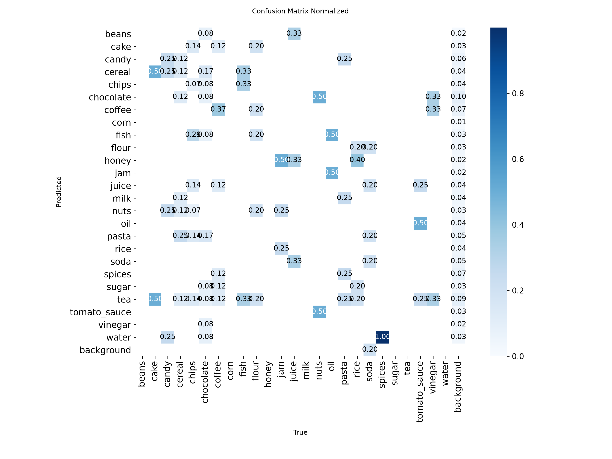
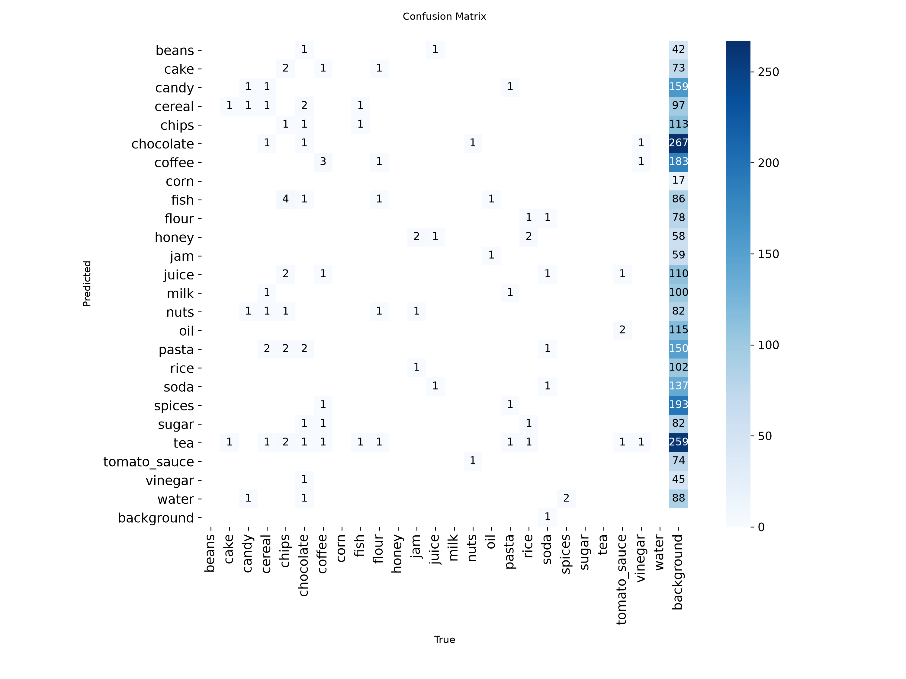

# Evaluation: grocereye_a_on_products6k (2026-10-27)

- Weights: `models/grocereye_a/best.pt`
- Data: `data/products6k/data.yaml`, split `test` (90 images, 90 labeled boxes)
- imgsz 320, stage A

## Dataset split

- Source: Products-6K https://zenodo.org/records/4428917
- Method: by product, stratified by class, val 0.15 / test 0.15, seed 0
- Images: train 417, val 98, test 90
- split.json: `data/products6k/split.json` (created 2026-10-27T16:21:07+00:00)

## Summary

| metric | value | target / baseline | status |
|---|---|---|---|
| mAP50 | 0.3737 | GrocerEye 0.8459 | below baseline (-47.22 pts) |
| mAP50 (NFR-5) | 0.3737 | >= 0.85 | FAIL |
| mAP50-95 | 0.3375 | - | - |

GrocerEye's 84.59% is Darknet mAP@0.5 on its own (unpublished) random 20% test split, so the comparison is approximate.

## Per-class results

Ultralytics P/R are at the max-F1 confidence; operating-point P/R are at conf 0.50, IoU >= 0.5.

| class | images | boxes | AP50 | AP50-95 | P (val) | R (val) | P @op | R @op | TP | FP | FN |
|---|---|---|---|---|---|---|---|---|---|---|---|
| cake | 2 | 2 | 0.043 | 0.036 | 0.000 | 0.000 | 0.000 | 0.000 | 0 | 2 | 2 |
| candy | 4 | 4 | 0.376 | 0.346 | 0.300 | 0.750 | 0.333 | 0.500 | 2 | 4 | 2 |
| cereal | 8 | 8 | 0.364 | 0.362 | 0.526 | 0.250 | 0.667 | 0.250 | 2 | 1 | 6 |
| chips | 14 | 14 | 0.146 | 0.132 | 0.360 | 0.143 | 1.000 | 0.143 | 2 | 0 | 12 |
| chocolate | 12 | 12 | 0.239 | 0.168 | 0.255 | 0.500 | 0.250 | 0.333 | 4 | 12 | 8 |
| coffee | 8 | 8 | 0.264 | 0.199 | 0.285 | 0.250 | 0.333 | 0.125 | 1 | 2 | 7 |
| fish | 3 | 3 | 0.078 | 0.078 | 0.000 | 0.000 | 0.000 | 0.000 | 0 | 2 | 3 |
| flour | 5 | 5 | 0.050 | 0.045 | 0.000 | 0.000 | - | 0.000 | 0 | 0 | 5 |
| jam | 4 | 4 | 0.828 | 0.766 | 0.657 | 0.965 | 1.000 | 0.500 | 2 | 0 | 2 |
| juice | 3 | 3 | 0.427 | 0.412 | 0.189 | 0.667 | 0.500 | 0.333 | 1 | 1 | 2 |
| nuts | 2 | 2 | 0.495 | 0.495 | 0.138 | 0.500 | 0.500 | 0.500 | 1 | 1 | 1 |
| oil | 2 | 2 | 0.828 | 0.563 | 0.733 | 0.500 | - | 0.000 | 0 | 0 | 2 |
| pasta | 4 | 4 | 0.342 | 0.231 | 0.661 | 0.491 | - | 0.000 | 0 | 0 | 4 |
| rice | 5 | 5 | 0.624 | 0.624 | 0.477 | 0.600 | 0.500 | 0.200 | 1 | 1 | 4 |
| soda | 5 | 5 | 0.252 | 0.252 | 0.184 | 0.200 | 0.167 | 0.200 | 1 | 5 | 4 |
| spices | 2 | 2 | 0.043 | 0.040 | 0.000 | 0.000 | 0.000 | 0.000 | 0 | 4 | 2 |
| tomato_sauce | 4 | 4 | 0.995 | 0.995 | 0.710 | 1.000 | 1.000 | 0.500 | 2 | 0 | 2 |
| vinegar | 3 | 3 | 0.332 | 0.332 | 0.000 | 0.000 | 0.000 | 0.000 | 0 | 4 | 3 |

## Confusion matrix (conf 0.50, IoU >= 0.5, rows = true class)

| true \ pred | beans | cake | candy | cereal | chips | chocolate | coffee | corn | fish | flour | honey | jam | juice | milk | nuts | oil | pasta | rice | soda | spices | sugar | tea | tomato_sauce | vinegar | water | background |
|---|---|---|---|---|---|---|---|---|---|---|---|---|---|---|---|---|---|---|---|---|---|---|---|---|---|---|
| beans | . | . | . | . | . | . | . | . | . | . | . | . | . | . | . | . | . | . | . | . | . | . | . | . | . | . |
| cake | . | . | . | . | . | . | . | . | . | . | . | . | . | . | . | . | . | . | . | . | . | . | . | . | . | 2 |
| candy | . | . | **2** | . | . | . | . | . | . | . | . | . | . | . | . | . | . | . | . | . | . | . | . | . | . | 2 |
| cereal | . | . | . | **2** | . | 2 | . | . | 1 | . | . | . | . | . | . | . | . | . | . | . | . | 1 | . | . | . | 2 |
| chips | . | . | 3 | 1 | **2** | 2 | . | . | . | . | . | . | . | . | 1 | . | . | . | . | . | . | . | . | . | . | 5 |
| chocolate | . | . | . | . | . | **4** | 1 | . | . | . | . | . | . | . | . | . | . | . | 1 | . | . | 1 | . | . | . | 5 |
| coffee | . | . | . | . | . | 1 | **1** | . | . | . | . | . | . | . | . | . | . | . | . | 2 | . | 1 | . | . | . | 3 |
| corn | . | . | . | . | . | . | . | . | . | . | . | . | . | . | . | . | . | . | . | . | . | . | . | . | . | . |
| fish | . | 1 | . | . | . | . | . | . | . | . | . | . | . | . | . | . | . | . | . | . | . | . | . | . | . | 2 |
| flour | . | 1 | . | . | . | 2 | . | . | . | . | . | . | . | . | . | . | . | 1 | . | . | . | 1 | . | . | . | . |
| honey | . | . | . | . | . | . | . | . | . | . | . | . | . | . | . | . | . | . | . | . | . | . | . | . | . | . |
| jam | . | . | . | . | . | . | . | . | . | . | 2 | **2** | . | . | . | . | . | . | . | . | . | . | . | . | . | . |
| juice | . | . | . | . | . | . | . | . | . | . | . | . | . | . | . | . | . | . | 1 | . | . | . | . | 2 | . | . |
| milk | . | . | . | . | . | . | . | . | . | . | . | . | . | . | . | . | . | . | . | . | . | . | . | . | . | . |
| nuts | . | . | . | . | . | 1 | . | . | . | . | . | . | . | . | **1** | . | . | . | . | . | . | . | . | . | . | . |
| oil | . | . | . | . | . | . | . | . | . | . | . | . | . | . | . | . | . | . | . | . | . | . | . | 2 | . | . |
| pasta | . | . | . | . | . | . | . | . | . | . | . | . | . | . | . | . | . | . | . | . | . | . | . | . | . | 4 |
| rice | . | . | . | . | . | . | . | . | . | . | . | . | . | 1 | . | . | . | **1** | . | 1 | . | 1 | . | . | . | 1 |
| soda | . | . | . | . | . | . | . | . | . | . | 1 | . | . | . | . | . | . | . | **1** | 1 | . | . | . | . | . | 2 |
| spices | . | . | . | . | . | . | . | . | . | . | . | . | . | . | . | . | . | . | . | . | . | . | . | . | . | 2 |
| sugar | . | . | . | . | . | . | . | . | . | . | . | . | . | . | . | . | . | . | . | . | . | . | . | . | . | . |
| tea | . | . | . | . | . | . | . | . | . | . | . | . | . | . | . | . | . | . | . | . | . | . | . | . | . | . |
| tomato_sauce | . | . | . | . | . | . | . | . | 1 | . | . | . | . | . | . | . | . | . | . | . | . | . | **2** | . | . | 1 |
| vinegar | . | . | . | . | . | . | . | . | . | . | . | . | 1 | . | . | . | . | . | 2 | . | . | . | . | . | . | . |
| water | . | . | . | . | . | . | . | . | . | . | . | . | . | . | . | . | . | . | . | . | . | . | . | . | . | . |
| background | . | . | 1 | . | . | 4 | 1 | . | . | . | . | . | 1 | 1 | . | . | . | . | 1 | . | . | 5 | . | . | . | . |

Ultralytics confusion-matrix PNGs are computed at its val conf (0.001), so they show more low-confidence detections than the table above.

## Speed (ms per image, this machine)

preprocess 0.6, inference 3.7, loss 0.0, postprocess 1.5
