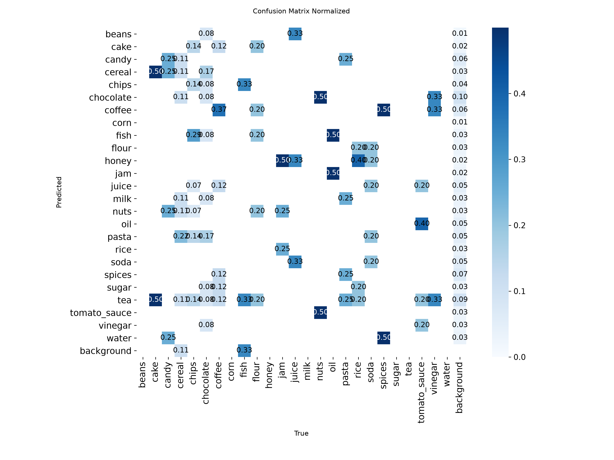
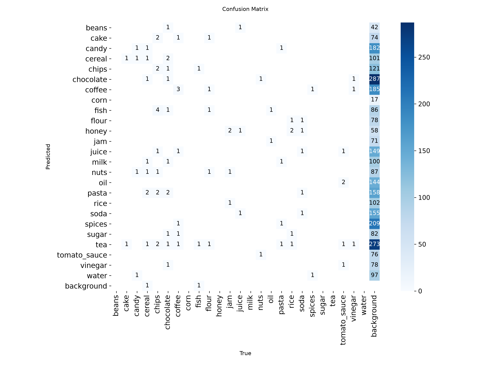

# Evaluation: grocereye_a_on_products6k_v2 (2026-10-28)

- Weights: `models/grocereye_a/best.pt`
- Data: `data/products6k_v2/data.yaml`, split `test` (92 images, 92 labeled boxes)
- imgsz 320, stage A

## Dataset split

- Source: Products-6K https://zenodo.org/records/4428917
- Method: by product, stratified by class, val 0.15 / test 0.15, seed 0
- Images: train 428, val 101, test 92
- split.json: `data/products6k_v2/split.json` (created 2026-10-28T22:31:30+00:00)

## Summary

| metric | value | target / baseline | status |
|---|---|---|---|
| mAP50 | 0.2999 | GrocerEye 0.8459 | below baseline (-54.60 pts) |
| mAP50 (NFR-5) | 0.2999 | >= 0.85 | FAIL |
| mAP50-95 | 0.2757 | - | - |

GrocerEye's 84.59% is Darknet mAP@0.5 on its own (unpublished) random 20% test split, so the comparison is approximate.

## Per-class results

Ultralytics P/R are at the max-F1 confidence; operating-point P/R are at conf 0.50, IoU >= 0.5.

| class | images | boxes | AP50 | AP50-95 | P (val) | R (val) | P @op | R @op | TP | FP | FN |
|---|---|---|---|---|---|---|---|---|---|---|---|
| cake | 2 | 2 | 0.043 | 0.036 | 0.000 | 0.000 | 0.000 | 0.000 | 0 | 2 | 2 |
| candy | 4 | 4 | 0.315 | 0.289 | 0.265 | 0.750 | 0.286 | 0.500 | 2 | 5 | 2 |
| cereal | 9 | 9 | 0.327 | 0.325 | 0.501 | 0.223 | 0.667 | 0.222 | 2 | 1 | 7 |
| chips | 14 | 14 | 0.144 | 0.138 | 0.333 | 0.143 | 1.000 | 0.143 | 2 | 0 | 12 |
| chocolate | 12 | 12 | 0.187 | 0.127 | 0.209 | 0.417 | 0.188 | 0.250 | 3 | 13 | 9 |
| coffee | 8 | 8 | 0.263 | 0.199 | 0.278 | 0.250 | 0.333 | 0.125 | 1 | 2 | 7 |
| fish | 3 | 3 | 0.034 | 0.033 | 0.000 | 0.000 | 0.000 | 0.000 | 0 | 2 | 3 |
| flour | 5 | 5 | 0.050 | 0.045 | 0.000 | 0.000 | - | 0.000 | 0 | 0 | 5 |
| jam | 4 | 4 | 0.828 | 0.766 | 0.658 | 1.000 | 1.000 | 0.500 | 2 | 0 | 2 |
| juice | 3 | 3 | 0.407 | 0.396 | 0.127 | 0.667 | 0.333 | 0.333 | 1 | 2 | 2 |
| nuts | 2 | 2 | 0.495 | 0.495 | 0.137 | 0.500 | 0.500 | 0.500 | 1 | 1 | 1 |
| oil | 2 | 2 | 0.133 | 0.093 | 0.109 | 0.500 | 0.000 | 0.000 | 0 | 2 | 2 |
| pasta | 4 | 4 | 0.342 | 0.230 | 0.394 | 0.500 | - | 0.000 | 0 | 0 | 4 |
| rice | 5 | 5 | 0.624 | 0.624 | 0.468 | 0.600 | 0.500 | 0.200 | 1 | 1 | 4 |
| soda | 5 | 5 | 0.266 | 0.265 | 0.181 | 0.200 | 0.167 | 0.200 | 1 | 5 | 4 |
| spices | 2 | 2 | 0.042 | 0.036 | 0.000 | 0.000 | 0.000 | 0.000 | 0 | 4 | 2 |
| tomato_sauce | 5 | 5 | 0.795 | 0.760 | 0.702 | 0.800 | 1.000 | 0.400 | 2 | 0 | 3 |
| vinegar | 3 | 3 | 0.107 | 0.107 | 0.000 | 0.000 | 0.000 | 0.000 | 0 | 4 | 3 |

## Confusion matrix (conf 0.50, IoU >= 0.5, rows = true class)

| true \ pred | beans | cake | candy | cereal | chips | chocolate | coffee | corn | fish | flour | honey | jam | juice | milk | nuts | oil | pasta | rice | soda | spices | sugar | tea | tomato_sauce | vinegar | water | background |
|---|---|---|---|---|---|---|---|---|---|---|---|---|---|---|---|---|---|---|---|---|---|---|---|---|---|---|
| beans | . | . | . | . | . | . | . | . | . | . | . | . | . | . | . | . | . | . | . | . | . | . | . | . | . | . |
| cake | . | . | . | . | . | . | . | . | . | . | . | . | . | . | . | . | . | . | . | . | . | . | . | . | . | 2 |
| candy | . | . | **2** | . | . | . | . | . | . | . | . | . | . | . | . | . | . | . | . | . | . | . | . | . | . | 2 |
| cereal | . | . | . | **2** | . | 2 | . | . | 1 | . | . | . | . | . | . | . | . | . | . | . | . | 1 | . | . | . | 3 |
| chips | . | . | 3 | 1 | **2** | 2 | . | . | . | . | . | . | . | . | 1 | . | . | . | . | . | . | . | . | . | . | 5 |
| chocolate | . | . | . | . | . | **3** | 1 | . | . | . | . | . | . | . | . | . | . | . | . | . | . | 1 | . | . | . | 7 |
| coffee | . | . | . | . | . | 1 | **1** | . | . | . | . | . | . | . | . | . | . | . | . | 2 | . | 1 | . | . | . | 3 |
| corn | . | . | . | . | . | . | . | . | . | . | . | . | . | . | . | . | . | . | . | . | . | . | . | . | . | . |
| fish | . | 1 | . | . | . | . | . | . | . | . | . | . | . | . | . | . | . | . | . | . | . | . | . | . | . | 2 |
| flour | . | 1 | . | . | . | 2 | . | . | . | . | . | . | . | . | . | . | . | 1 | . | . | . | 1 | . | . | . | . |
| honey | . | . | . | . | . | . | . | . | . | . | . | . | . | . | . | . | . | . | . | . | . | . | . | . | . | . |
| jam | . | . | . | . | . | . | . | . | . | . | 2 | **2** | . | . | . | . | . | . | . | . | . | . | . | . | . | . |
| juice | . | . | . | . | . | . | . | . | . | . | . | . | . | . | . | . | . | . | 1 | . | . | . | . | 2 | . | . |
| milk | . | . | . | . | . | . | . | . | . | . | . | . | . | . | . | . | . | . | . | . | . | . | . | . | . | . |
| nuts | . | . | . | . | . | 1 | . | . | . | . | . | . | . | . | **1** | . | . | . | . | . | . | . | . | . | . | . |
| oil | . | . | . | . | . | . | . | . | . | . | . | . | . | . | . | . | . | . | . | . | . | . | . | 2 | . | . |
| pasta | . | . | . | . | . | . | . | . | . | . | . | . | . | . | . | . | . | . | . | . | . | . | . | . | . | 4 |
| rice | . | . | . | . | . | . | . | . | . | . | . | . | . | 1 | . | . | . | **1** | . | 1 | . | 1 | . | . | . | 1 |
| soda | . | . | . | . | . | . | . | . | . | . | 1 | . | . | . | . | . | . | . | **1** | 1 | . | . | . | . | . | 2 |
| spices | . | . | . | . | . | . | . | . | . | . | . | . | . | . | . | . | . | . | . | . | . | . | . | . | . | 2 |
| sugar | . | . | . | . | . | . | . | . | . | . | . | . | . | . | . | . | . | . | . | . | . | . | . | . | . | . |
| tea | . | . | . | . | . | . | . | . | . | . | . | . | . | . | . | . | . | . | . | . | . | . | . | . | . | . |
| tomato_sauce | . | . | . | . | . | . | . | . | 1 | . | . | . | 1 | . | . | . | . | . | . | . | . | . | **2** | . | . | 1 |
| vinegar | . | . | . | . | . | . | . | . | . | . | . | . | 1 | . | . | . | . | . | 2 | . | . | . | . | . | . | . |
| water | . | . | . | . | . | . | . | . | . | . | . | . | . | . | . | . | . | . | . | . | . | . | . | . | . | . |
| background | . | . | 2 | . | . | 5 | 1 | . | . | . | . | . | 1 | 1 | . | 2 | . | . | 2 | . | . | 5 | . | . | . | . |

Ultralytics confusion-matrix PNGs are computed at its val conf (0.001), so they show more low-confidence detections than the table above.

## Speed (ms per image, this machine)

preprocess 0.9, inference 2.7, loss 0.0, postprocess 1.6
