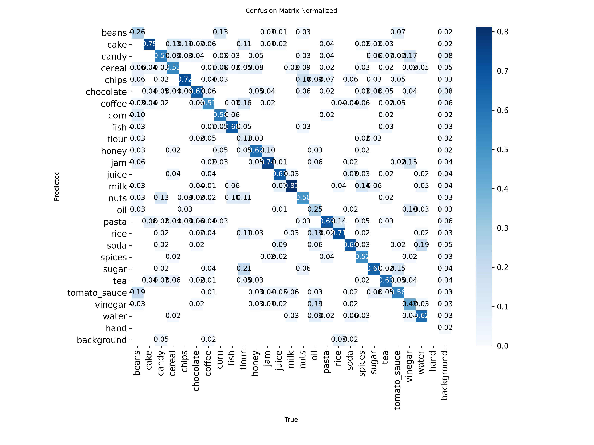
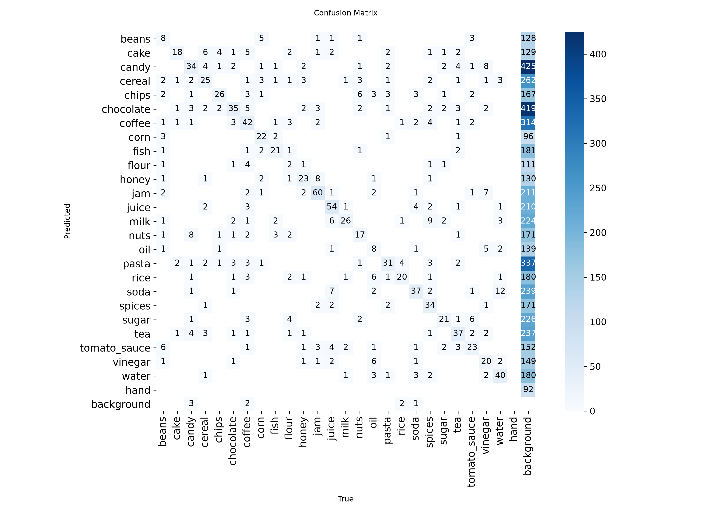

# Evaluation: grocereye_hand (2026-10-28)

- Weights: `models/grocereye_hand/best.pt`
- Data: `data/grocereye/data.yaml`, split `test` (495 images, 1152 labeled boxes)
- imgsz 320, stage A

## Dataset split

- Source: archive master.zip
- Method: stratified by class 80/10/10 train/val/test, seed 0
- Images: train 3957, val 495, test 495
- split.json: `data/grocereye/split.json` (created 2026-10-06T15:54:43+00:00)

## Summary

| metric | value | target / baseline | status |
|---|---|---|---|
| mAP50 | 0.9248 | GrocerEye 0.8459 | beats baseline (+7.89 pts) |
| mAP50 (NFR-5) | 0.9248 | >= 0.85 | PASS |
| mAP50-95 | 0.8040 | - | - |

GrocerEye's 84.59% is Darknet mAP@0.5 on its own (unpublished) random 20% test split, so the comparison is approximate.

## Per-class results

Ultralytics P/R are at the max-F1 confidence; operating-point P/R are at conf 0.50, IoU >= 0.5.

| class | images | boxes | AP50 | AP50-95 | P (val) | R (val) | P @op | R @op | TP | FP | FN |
|---|---|---|---|---|---|---|---|---|---|---|---|
| beans | 14 | 31 | 0.954 | 0.862 | 0.917 | 0.715 | 0.920 | 0.742 | 23 | 2 | 8 |
| cake | 16 | 24 | 0.971 | 0.889 | 0.700 | 0.917 | 0.639 | 0.958 | 23 | 13 | 1 |
| candy | 37 | 60 | 0.859 | 0.706 | 0.892 | 0.750 | 0.807 | 0.767 | 46 | 11 | 14 |
| cereal | 28 | 47 | 0.971 | 0.852 | 0.938 | 0.915 | 0.793 | 0.979 | 46 | 12 | 1 |
| chips | 18 | 36 | 0.970 | 0.838 | 0.961 | 0.833 | 0.889 | 0.889 | 32 | 4 | 4 |
| chocolate | 31 | 52 | 0.928 | 0.738 | 0.861 | 0.836 | 0.839 | 0.904 | 47 | 9 | 5 |
| coffee | 30 | 82 | 0.916 | 0.808 | 0.952 | 0.719 | 0.892 | 0.805 | 66 | 8 | 16 |
| corn | 10 | 38 | 0.962 | 0.879 | 0.845 | 0.974 | 0.750 | 0.947 | 36 | 12 | 2 |
| fish | 11 | 31 | 0.960 | 0.819 | 0.900 | 0.903 | 0.824 | 0.903 | 28 | 6 | 3 |
| flour | 11 | 19 | 0.798 | 0.658 | 1.000 | 0.547 | 0.833 | 0.526 | 10 | 2 | 9 |
| honey | 18 | 37 | 0.948 | 0.816 | 0.787 | 0.838 | 0.720 | 0.973 | 36 | 14 | 1 |
| jam | 24 | 81 | 0.985 | 0.888 | 0.974 | 0.925 | 0.862 | 1.000 | 81 | 13 | 0 |
| juice | 30 | 80 | 0.961 | 0.874 | 0.941 | 0.900 | 0.887 | 0.887 | 71 | 9 | 9 |
| milk | 16 | 32 | 0.990 | 0.862 | 0.940 | 0.975 | 0.833 | 0.938 | 30 | 6 | 2 |
| nuts | 17 | 34 | 0.906 | 0.731 | 0.992 | 0.735 | 0.963 | 0.765 | 26 | 1 | 8 |
| oil | 14 | 32 | 0.867 | 0.773 | 0.890 | 0.781 | 0.757 | 0.875 | 28 | 9 | 4 |
| pasta | 17 | 45 | 0.920 | 0.740 | 0.891 | 0.711 | 0.829 | 0.644 | 29 | 6 | 16 |
| rice | 15 | 28 | 0.881 | 0.816 | 0.869 | 0.857 | 0.667 | 0.857 | 24 | 12 | 4 |
| soda | 18 | 54 | 0.847 | 0.706 | 0.897 | 0.805 | 0.839 | 0.870 | 47 | 9 | 7 |
| spices | 21 | 65 | 0.961 | 0.869 | 0.932 | 0.840 | 0.824 | 0.862 | 56 | 12 | 9 |
| sugar | 12 | 32 | 0.851 | 0.708 | 0.832 | 0.774 | 0.703 | 0.812 | 26 | 11 | 6 |
| tea | 28 | 59 | 0.872 | 0.772 | 0.861 | 0.737 | 0.806 | 0.847 | 50 | 12 | 9 |
| tomato_sauce | 17 | 41 | 0.954 | 0.859 | 0.847 | 0.951 | 0.741 | 0.976 | 40 | 14 | 1 |
| vinegar | 16 | 48 | 0.896 | 0.742 | 0.897 | 0.875 | 0.778 | 0.875 | 42 | 12 | 6 |
| water | 26 | 64 | 0.992 | 0.894 | 0.943 | 1.000 | 0.901 | 1.000 | 64 | 7 | 0 |

## Confusion matrix (conf 0.50, IoU >= 0.5, rows = true class)

| true \ pred | beans | cake | candy | cereal | chips | chocolate | coffee | corn | fish | flour | honey | jam | juice | milk | nuts | oil | pasta | rice | soda | spices | sugar | tea | tomato_sauce | vinegar | water | hand | background |
|---|---|---|---|---|---|---|---|---|---|---|---|---|---|---|---|---|---|---|---|---|---|---|---|---|---|---|---|
| beans | **22** | . | . | . | . | . | . | 3 | . | . | . | . | . | . | . | . | . | . | . | . | . | . | 4 | . | . | . | 2 |
| cake | . | **23** | . | . | . | . | . | . | . | . | . | . | . | . | . | . | . | . | . | . | . | . | . | . | . | . | 1 |
| candy | . | . | **46** | . | . | 1 | . | . | . | . | . | . | . | . | . | . | . | . | . | . | . | . | . | . | . | . | 13 |
| cereal | . | . | . | **46** | . | . | . | . | . | . | . | . | . | . | . | . | . | . | . | . | . | . | . | . | . | . | 1 |
| chips | . | . | . | . | **32** | . | . | . | . | . | . | . | . | . | . | . | . | . | . | . | . | . | . | . | . | . | 4 |
| chocolate | . | . | . | . | . | **47** | . | . | . | . | . | . | . | . | . | . | . | . | . | . | 1 | . | . | . | . | . | 4 |
| coffee | . | . | . | 1 | . | 1 | **66** | . | . | . | . | 1 | . | . | . | . | . | . | . | . | . | 2 | . | . | . | . | 11 |
| corn | . | . | . | . | . | . | . | **36** | . | . | . | . | . | . | . | . | . | . | . | . | . | . | . | . | . | . | 2 |
| fish | . | . | . | . | . | . | . | . | **28** | . | . | . | . | . | . | . | . | . | . | . | . | . | . | . | . | . | 3 |
| flour | . | . | . | . | . | . | . | . | . | **9** | . | . | . | . | . | . | . | 1 | . | 1 | . | . | . | . | . | . | 8 |
| honey | . | . | . | . | . | . | . | . | . | . | **36** | . | . | . | . | . | . | . | . | . | . | . | . | . | . | . | 1 |
| jam | . | . | . | . | . | . | . | . | . | . | . | **81** | . | . | . | . | . | . | . | . | . | . | . | . | . | . | . |
| juice | . | . | . | . | . | . | . | . | . | . | . | . | **71** | . | . | . | . | . | 1 | . | . | . | 1 | . | . | . | 7 |
| milk | . | . | . | . | . | . | . | . | . | . | . | . | . | **30** | . | . | . | . | . | . | . | . | . | . | . | . | 2 |
| nuts | . | . | 1 | . | . | . | . | . | . | . | . | . | . | . | **26** | . | . | . | . | . | . | . | . | . | . | . | 7 |
| oil | . | . | . | . | . | . | . | . | . | . | . | . | . | . | . | **26** | . | . | . | . | . | . | . | 4 | . | . | 2 |
| pasta | . | . | . | . | . | . | . | . | . | . | . | . | . | . | . | . | **29** | . | . | . | . | . | . | . | . | . | 16 |
| rice | . | . | . | . | . | . | . | . | . | . | . | . | . | . | . | . | . | **24** | . | . | . | . | . | . | . | . | 4 |
| soda | . | . | . | . | . | . | . | . | . | . | . | . | . | . | . | . | . | . | **47** | . | . | . | . | . | 2 | . | 5 |
| spices | . | . | . | . | . | . | . | . | . | . | . | . | . | . | . | . | . | 3 | . | **56** | . | . | . | . | 1 | . | 5 |
| sugar | . | . | . | . | . | . | . | . | . | . | . | . | . | . | . | . | . | 1 | . | . | **26** | 1 | 1 | . | . | . | 3 |
| tea | . | 2 | . | 1 | . | . | . | . | . | . | . | . | . | . | . | . | . | . | . | . | . | **50** | . | . | . | . | 6 |
| tomato_sauce | . | . | . | . | . | . | . | . | . | . | . | . | . | . | . | . | . | . | 1 | . | . | . | **40** | . | . | . | . |
| vinegar | . | . | . | . | . | . | . | . | . | . | . | . | . | . | . | 3 | . | . | . | . | . | . | . | **42** | . | . | 3 |
| water | . | . | . | . | . | . | . | . | . | . | . | . | . | . | . | . | . | . | . | . | . | . | . | . | **64** | . | . |
| hand | . | . | . | . | . | . | . | . | . | . | . | . | . | . | . | . | . | . | . | . | . | . | . | . | . | . | . |
| background | 3 | 11 | 10 | 10 | 4 | 7 | 8 | 9 | 6 | 3 | 14 | 12 | 9 | 6 | 1 | 8 | 6 | 7 | 7 | 11 | 10 | 9 | 8 | 8 | 4 | . | . |

Ultralytics confusion-matrix PNGs are computed at its val conf (0.001), so they show more low-confidence detections than the table above.

## Speed (ms per image, this machine)

preprocess 5.9, inference 1.5, loss 0.0, postprocess 1.6
