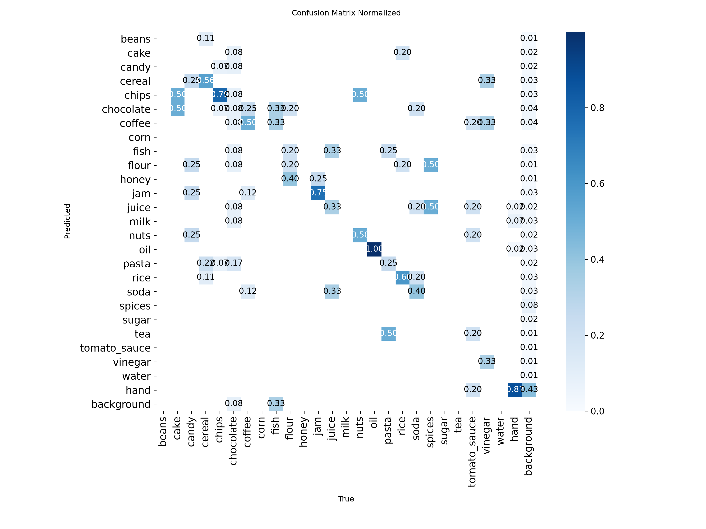
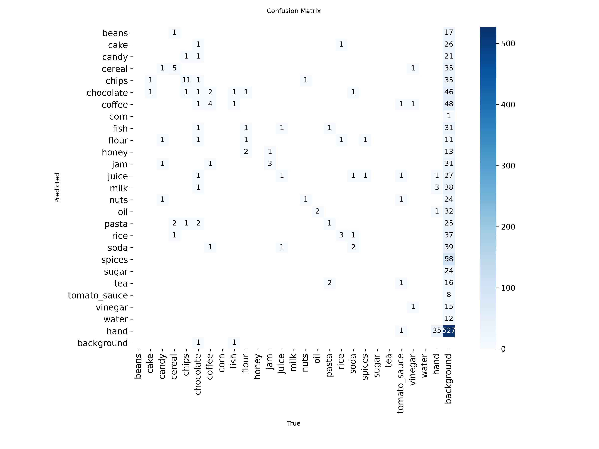

# Evaluation: grocereye_hand_on_products6k_hands (2026-10-28)

- Weights: `models/grocereye_hand/best.pt`
- Data: `data/products6k_hands/data.yaml`, split `test` (112 images, 132 labeled boxes)
- imgsz 320, stage A

## Dataset split

- split.json not found; split unknown.

## Summary

| metric | value | target / baseline | status |
|---|---|---|---|
| mAP50 | 0.7550 | GrocerEye 0.8459 | below baseline (-9.09 pts) |
| mAP50 (NFR-5) | 0.7550 | >= 0.85 | FAIL |
| mAP50-95 | 0.7196 | - | - |

GrocerEye's 84.59% is Darknet mAP@0.5 on its own (unpublished) random 20% test split, so the comparison is approximate.

## Per-class results

Ultralytics P/R are at the max-F1 confidence; operating-point P/R are at conf 0.50, IoU >= 0.5.

| class | images | boxes | AP50 | AP50-95 | P (val) | R (val) | P @op | R @op | TP | FP | FN |
|---|---|---|---|---|---|---|---|---|---|---|---|
| cake | 2 | 2 | 0.995 | 0.945 | 0.806 | 1.000 | 1.000 | 1.000 | 2 | 0 | 0 |
| candy | 4 | 4 | 0.807 | 0.807 | 1.000 | 0.699 | 1.000 | 0.250 | 1 | 0 | 3 |
| cereal | 9 | 9 | 0.975 | 0.938 | 1.000 | 0.874 | 0.889 | 0.889 | 8 | 1 | 1 |
| chips | 14 | 14 | 0.842 | 0.824 | 0.764 | 0.925 | 0.706 | 0.857 | 12 | 5 | 2 |
| chocolate | 12 | 12 | 0.560 | 0.529 | 0.604 | 0.583 | 0.667 | 0.500 | 6 | 3 | 6 |
| coffee | 8 | 8 | 0.995 | 0.995 | 0.865 | 1.000 | 0.800 | 1.000 | 8 | 2 | 0 |
| fish | 3 | 3 | 0.443 | 0.443 | 0.658 | 0.650 | 0.333 | 0.333 | 1 | 2 | 2 |
| flour | 5 | 5 | 0.720 | 0.720 | 1.000 | 0.000 | 1.000 | 0.200 | 1 | 0 | 4 |
| jam | 4 | 4 | 0.995 | 0.995 | 0.847 | 1.000 | 0.800 | 1.000 | 4 | 1 | 0 |
| juice | 3 | 3 | 0.219 | 0.202 | 1.000 | 0.000 | 1.000 | 0.333 | 1 | 0 | 2 |
| nuts | 2 | 2 | 0.745 | 0.745 | 0.463 | 0.890 | 0.500 | 1.000 | 2 | 2 | 0 |
| oil | 2 | 2 | 0.995 | 0.795 | 0.374 | 1.000 | 0.667 | 1.000 | 2 | 1 | 0 |
| pasta | 4 | 4 | 0.534 | 0.519 | 1.000 | 0.486 | 1.000 | 0.250 | 1 | 0 | 3 |
| rice | 5 | 5 | 0.995 | 0.995 | 0.653 | 1.000 | 0.833 | 1.000 | 5 | 1 | 0 |
| soda | 5 | 5 | 0.490 | 0.434 | 0.425 | 0.170 | 0.000 | 0.000 | 0 | 1 | 5 |
| spices | 2 | 2 | 0.662 | 0.546 | 0.725 | 0.500 | 1.000 | 0.500 | 1 | 0 | 1 |
| tomato_sauce | 5 | 5 | 0.395 | 0.395 | 0.812 | 0.400 | 0.667 | 0.400 | 2 | 1 | 3 |
| vinegar | 3 | 3 | 0.995 | 0.995 | 0.856 | 1.000 | 1.000 | 1.000 | 3 | 0 | 0 |
| hand | 40 | 40 | 0.982 | 0.848 | 0.874 | 0.975 | 0.929 | 0.975 | 39 | 3 | 1 |

## Confusion matrix (conf 0.50, IoU >= 0.5, rows = true class)

| true \ pred | beans | cake | candy | cereal | chips | chocolate | coffee | corn | fish | flour | honey | jam | juice | milk | nuts | oil | pasta | rice | soda | spices | sugar | tea | tomato_sauce | vinegar | water | hand | background |
|---|---|---|---|---|---|---|---|---|---|---|---|---|---|---|---|---|---|---|---|---|---|---|---|---|---|---|---|
| beans | . | . | . | . | . | . | . | . | . | . | . | . | . | . | . | . | . | . | . | . | . | . | . | . | . | . | . |
| cake | . | **2** | . | . | . | . | . | . | . | . | . | . | . | . | . | . | . | . | . | . | . | . | . | . | . | . | . |
| candy | . | . | . | . | 2 | 1 | 1 | . | . | . | . | . | . | . | . | . | . | . | . | . | . | . | . | . | . | . | . |
| cereal | . | . | . | **7** | . | . | 1 | . | . | . | . | . | . | . | . | . | . | . | . | . | . | . | . | . | . | . | 1 |
| chips | . | . | . | . | **12** | . | . | . | . | . | . | . | . | . | 1 | . | . | . | . | . | . | . | . | . | . | . | 1 |
| chocolate | . | . | . | . | . | **6** | . | . | 1 | . | . | . | . | . | . | . | . | . | . | . | . | . | . | . | . | . | 5 |
| coffee | . | . | . | . | . | . | **8** | . | . | . | . | . | . | . | . | . | . | . | . | . | . | . | . | . | . | . | . |
| corn | . | . | . | . | . | . | . | . | . | . | . | . | . | . | . | . | . | . | . | . | . | . | . | . | . | . | . |
| fish | . | . | . | . | . | . | . | . | **1** | . | . | . | . | . | . | . | . | . | . | . | . | . | . | . | . | . | 2 |
| flour | . | . | . | . | . | . | . | . | . | . | . | 1 | . | . | 1 | . | . | . | . | . | . | . | . | . | . | . | 3 |
| honey | . | . | . | . | . | . | . | . | . | . | . | . | . | . | . | . | . | . | . | . | . | . | . | . | . | . | . |
| jam | . | . | . | . | . | . | . | . | . | . | . | **4** | . | . | . | . | . | . | . | . | . | . | . | . | . | . | . |
| juice | . | . | . | . | . | . | . | . | . | . | . | . | **1** | . | . | 1 | . | . | 1 | . | . | . | . | . | . | . | . |
| milk | . | . | . | . | . | . | . | . | . | . | . | . | . | . | . | . | . | . | . | . | . | . | . | . | . | . | . |
| nuts | . | . | . | . | 1 | . | . | . | . | . | . | . | . | . | **1** | . | . | . | . | . | . | . | . | . | . | . | . |
| oil | . | . | . | . | . | . | . | . | . | . | . | . | . | . | . | **2** | . | . | . | . | . | . | . | . | . | . | . |
| pasta | . | . | . | . | . | 1 | . | . | . | . | . | . | . | . | . | . | **1** | . | . | . | . | . | . | . | . | . | 2 |
| rice | . | . | . | . | . | . | . | . | . | . | . | . | . | . | . | . | . | **5** | . | . | . | . | . | . | . | . | . |
| soda | . | . | . | . | . | . | . | . | . | . | . | . | . | . | . | . | . | 1 | . | . | . | . | . | . | . | . | 4 |
| spices | . | . | . | . | . | . | . | . | . | . | . | . | . | . | . | . | . | . | . | **1** | . | . | . | . | . | . | 1 |
| sugar | . | . | . | . | . | . | . | . | . | . | . | . | . | . | . | . | . | . | . | . | . | . | . | . | . | . | . |
| tea | . | . | . | . | . | . | . | . | . | . | . | . | . | . | . | . | . | . | . | . | . | . | . | . | . | . | . |
| tomato_sauce | . | . | . | . | . | . | . | . | . | . | . | . | . | . | . | . | . | . | . | . | . | . | **2** | . | . | . | 3 |
| vinegar | . | . | . | . | . | . | . | . | . | . | . | . | . | . | . | . | . | . | . | . | . | . | . | **3** | . | . | . |
| water | . | . | . | . | . | . | . | . | . | . | . | . | . | . | . | . | . | . | . | . | . | . | . | . | . | . | . |
| hand | . | . | . | . | . | . | . | . | . | . | . | . | . | . | . | . | . | . | . | . | . | . | . | . | . | **39** | 1 |
| background | . | . | 1 | 2 | 2 | 1 | . | . | 1 | 1 | . | . | . | . | 1 | . | . | . | . | . | . | . | 1 | . | . | 3 | . |

Ultralytics confusion-matrix PNGs are computed at its val conf (0.001), so they show more low-confidence detections than the table above.

## Speed (ms per image, this machine)

preprocess 1.0, inference 3.4, loss 0.0, postprocess 1.8
