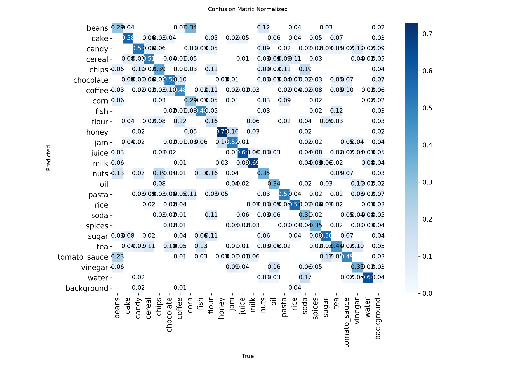
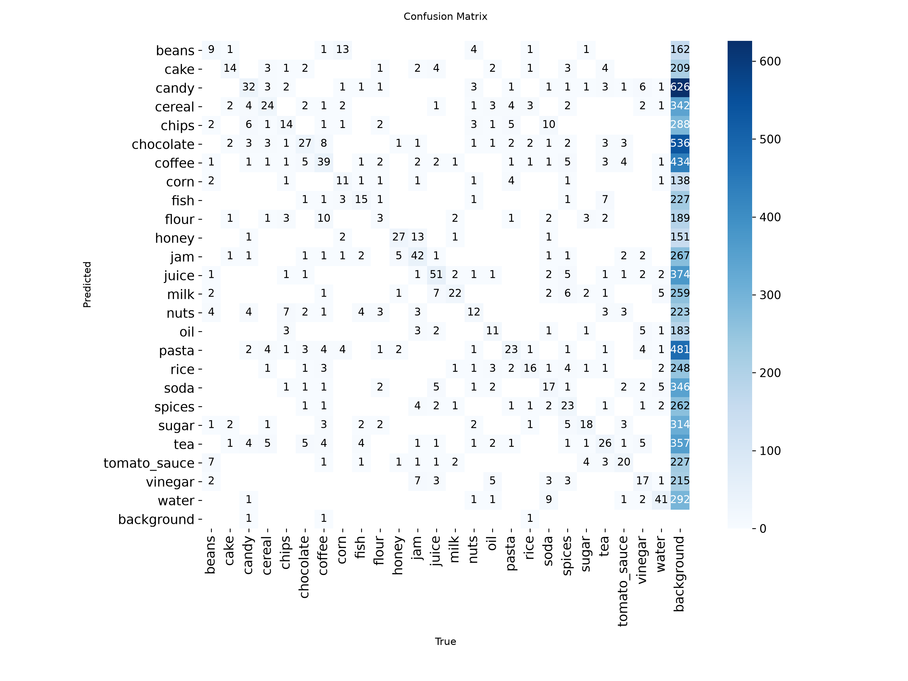

# Evaluation: grocereye_p6k2 (2026-10-28)

- Weights: `models/grocereye_p6k2/best.pt`
- Data: `data/grocereye/data.yaml`, split `test` (495 images, 1152 labeled boxes)
- imgsz 320, stage A

## Dataset split

- Source: archive master.zip
- Method: stratified by class 80/10/10 train/val/test, seed 0
- Images: train 3957, val 495, test 495
- split.json: `data/grocereye/split.json` (created 2026-10-06T15:54:43+00:00)

## Summary

| metric | value | target / baseline | status |
|---|---|---|---|
| mAP50 | 0.9215 | GrocerEye 0.8459 | beats baseline (+7.56 pts) |
| mAP50 (NFR-5) | 0.9215 | >= 0.85 | PASS |
| mAP50-95 | 0.7966 | - | - |

GrocerEye's 84.59% is Darknet mAP@0.5 on its own (unpublished) random 20% test split, so the comparison is approximate.

## Per-class results

Ultralytics P/R are at the max-F1 confidence; operating-point P/R are at conf 0.50, IoU >= 0.5.

| class | images | boxes | AP50 | AP50-95 | P (val) | R (val) | P @op | R @op | TP | FP | FN |
|---|---|---|---|---|---|---|---|---|---|---|---|
| beans | 14 | 31 | 0.974 | 0.884 | 0.951 | 0.903 | 0.929 | 0.839 | 26 | 2 | 5 |
| cake | 16 | 24 | 0.955 | 0.867 | 0.785 | 0.915 | 0.706 | 1.000 | 24 | 10 | 0 |
| candy | 37 | 60 | 0.878 | 0.713 | 0.896 | 0.716 | 0.796 | 0.717 | 43 | 11 | 17 |
| cereal | 28 | 47 | 0.964 | 0.855 | 0.956 | 0.914 | 0.875 | 0.894 | 42 | 6 | 5 |
| chips | 18 | 36 | 0.971 | 0.838 | 1.000 | 0.846 | 0.914 | 0.889 | 32 | 3 | 4 |
| chocolate | 31 | 52 | 0.933 | 0.729 | 0.917 | 0.846 | 0.833 | 0.865 | 45 | 9 | 7 |
| coffee | 30 | 82 | 0.921 | 0.818 | 0.934 | 0.768 | 0.908 | 0.841 | 69 | 7 | 13 |
| corn | 10 | 38 | 0.967 | 0.869 | 0.870 | 0.921 | 0.755 | 0.974 | 37 | 12 | 1 |
| fish | 11 | 31 | 0.948 | 0.804 | 0.896 | 0.871 | 0.757 | 0.903 | 28 | 9 | 3 |
| flour | 11 | 19 | 0.754 | 0.637 | 0.917 | 0.586 | 0.818 | 0.474 | 9 | 2 | 10 |
| honey | 18 | 37 | 0.927 | 0.799 | 0.783 | 0.838 | 0.686 | 0.946 | 35 | 16 | 2 |
| jam | 24 | 81 | 0.985 | 0.886 | 0.967 | 0.938 | 0.849 | 0.975 | 79 | 14 | 2 |
| juice | 30 | 80 | 0.956 | 0.879 | 0.865 | 0.938 | 0.833 | 0.938 | 75 | 15 | 5 |
| milk | 16 | 32 | 0.992 | 0.866 | 0.942 | 0.969 | 0.838 | 0.969 | 31 | 6 | 1 |
| nuts | 17 | 34 | 0.883 | 0.666 | 1.000 | 0.692 | 0.920 | 0.676 | 23 | 2 | 11 |
| oil | 14 | 32 | 0.893 | 0.818 | 0.862 | 0.778 | 0.730 | 0.844 | 27 | 10 | 5 |
| pasta | 17 | 45 | 0.873 | 0.691 | 0.818 | 0.733 | 0.708 | 0.756 | 34 | 14 | 11 |
| rice | 15 | 28 | 0.885 | 0.833 | 0.825 | 0.843 | 0.727 | 0.857 | 24 | 9 | 4 |
| soda | 18 | 54 | 0.859 | 0.701 | 0.925 | 0.815 | 0.843 | 0.796 | 43 | 8 | 11 |
| spices | 21 | 65 | 0.963 | 0.860 | 0.905 | 0.878 | 0.826 | 0.877 | 57 | 12 | 8 |
| sugar | 12 | 32 | 0.844 | 0.682 | 0.823 | 0.750 | 0.676 | 0.781 | 25 | 12 | 7 |
| tea | 28 | 59 | 0.883 | 0.751 | 0.834 | 0.765 | 0.774 | 0.814 | 48 | 14 | 11 |
| tomato_sauce | 17 | 41 | 0.955 | 0.838 | 0.905 | 0.902 | 0.765 | 0.951 | 39 | 12 | 2 |
| vinegar | 16 | 48 | 0.890 | 0.745 | 0.835 | 0.896 | 0.778 | 0.875 | 42 | 12 | 6 |
| water | 26 | 64 | 0.985 | 0.886 | 0.915 | 0.984 | 0.889 | 1.000 | 64 | 8 | 0 |

## Confusion matrix (conf 0.50, IoU >= 0.5, rows = true class)

| true \ pred | beans | cake | candy | cereal | chips | chocolate | coffee | corn | fish | flour | honey | jam | juice | milk | nuts | oil | pasta | rice | soda | spices | sugar | tea | tomato_sauce | vinegar | water | background |
|---|---|---|---|---|---|---|---|---|---|---|---|---|---|---|---|---|---|---|---|---|---|---|---|---|---|---|
| beans | **26** | . | . | . | . | . | . | . | . | . | . | . | . | . | . | . | . | . | . | . | . | . | 2 | . | . | 3 |
| cake | . | **24** | . | . | . | . | . | . | . | . | . | . | . | . | . | . | . | . | . | . | . | . | . | . | . | . |
| candy | . | . | **43** | . | 1 | 1 | . | . | . | . | . | . | . | . | . | . | . | . | . | . | . | . | . | . | . | 15 |
| cereal | . | . | . | **42** | . | . | . | . | . | . | . | . | . | . | . | . | 1 | . | . | . | . | . | . | . | . | 4 |
| chips | . | . | . | . | **32** | . | . | . | . | . | . | . | . | . | . | . | . | . | . | . | . | . | . | . | . | 4 |
| chocolate | . | . | . | . | . | **45** | . | . | . | . | . | . | . | . | . | . | . | . | . | . | 1 | . | . | . | . | 6 |
| coffee | . | . | . | . | . | . | **69** | . | . | . | . | 1 | . | . | . | . | . | . | . | . | . | 2 | . | . | . | 10 |
| corn | . | . | . | . | . | . | . | **37** | . | . | . | . | . | . | . | . | . | . | . | . | . | . | . | . | . | 1 |
| fish | . | . | . | . | . | . | . | . | **28** | . | . | . | . | . | . | . | . | . | . | . | . | . | . | . | . | 3 |
| flour | . | . | . | . | . | . | . | . | . | **9** | . | . | . | . | . | . | 1 | 1 | . | . | 2 | . | . | . | . | 6 |
| honey | . | . | . | . | . | . | . | . | . | . | **35** | . | . | . | . | . | . | . | . | . | . | . | . | . | . | 2 |
| jam | . | . | . | . | . | . | . | . | . | . | 1 | **79** | . | . | . | . | . | . | . | . | . | . | . | . | . | 1 |
| juice | . | . | . | . | . | . | . | . | . | . | . | . | **75** | 1 | . | . | . | . | 3 | . | . | . | . | . | . | 1 |
| milk | . | . | . | . | . | . | . | . | . | . | . | . | 1 | **31** | . | . | . | . | . | . | . | . | . | . | . | . |
| nuts | . | . | 1 | . | . | . | . | . | . | . | . | . | 1 | . | **23** | . | . | . | . | . | . | 1 | . | . | . | 8 |
| oil | . | . | . | . | . | . | . | . | . | . | . | . | . | . | . | **26** | . | . | . | . | . | . | . | 3 | . | 3 |
| pasta | . | . | . | . | . | . | . | . | . | . | . | . | 1 | . | . | . | **34** | . | . | . | . | . | . | . | . | 10 |
| rice | . | . | . | . | . | . | . | . | . | . | . | . | . | . | . | . | 2 | **24** | . | . | . | . | . | . | . | 2 |
| soda | . | . | . | . | . | . | . | . | . | . | . | . | . | . | . | . | . | . | **43** | . | . | . | . | . | 2 | 9 |
| spices | . | . | . | . | . | . | 2 | . | . | . | . | . | . | . | . | . | . | 2 | . | **55** | . | . | . | . | . | 6 |
| sugar | . | . | . | . | . | . | . | . | . | . | . | . | . | . | . | . | 1 | . | . | . | **25** | 1 | . | . | . | 5 |
| tea | . | 2 | . | 1 | . | . | . | . | 2 | . | . | . | . | . | . | . | . | . | . | . | . | **48** | . | . | . | 6 |
| tomato_sauce | . | . | . | . | . | . | . | . | . | . | . | . | . | . | . | . | . | . | . | . | . | . | **39** | 1 | . | 1 |
| vinegar | . | . | . | . | . | . | . | . | . | . | . | . | . | . | . | 2 | . | . | . | . | . | . | . | **42** | 3 | 1 |
| water | . | . | . | . | . | . | . | . | . | . | . | . | . | . | . | . | . | . | . | . | . | . | . | . | **64** | . |
| background | 2 | 8 | 10 | 5 | 2 | 8 | 5 | 12 | 7 | 2 | 15 | 13 | 12 | 5 | 2 | 9 | 9 | 6 | 5 | 14 | 9 | 10 | 10 | 8 | 3 | . |

Ultralytics confusion-matrix PNGs are computed at its val conf (0.001), so they show more low-confidence detections than the table above.

## Speed (ms per image, this machine)

preprocess 0.7, inference 1.3, loss 0.0, postprocess 1.4
