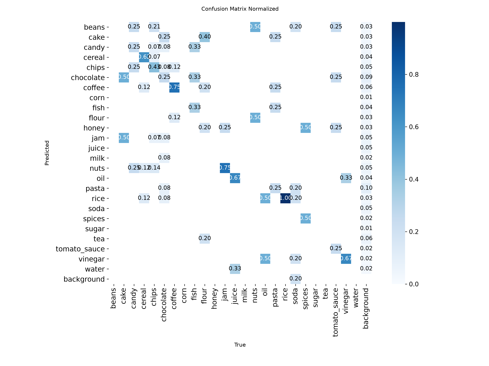
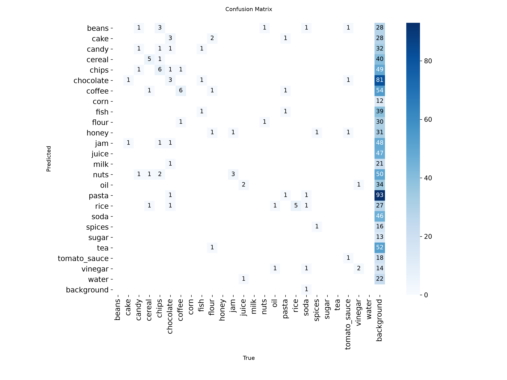

# Evaluation: grocereye_p6k_on_products6k (2026-10-27)

- Weights: `models/grocereye_p6k/best.pt`
- Data: `data/products6k/data.yaml`, split `test` (90 images, 90 labeled boxes)
- imgsz 320, stage A

## Dataset split

- Source: Products-6K https://zenodo.org/records/4428917
- Method: by product, stratified by class, val 0.15 / test 0.15, seed 0
- Images: train 417, val 98, test 90
- split.json: `data/products6k/split.json` (created 2026-10-27T16:21:07+00:00)

## Summary

| metric | value | target / baseline | status |
|---|---|---|---|
| mAP50 | 0.8217 | GrocerEye 0.8459 | below baseline (-2.42 pts) |
| mAP50 (NFR-5) | 0.8217 | >= 0.85 | FAIL |
| mAP50-95 | 0.7929 | - | - |

GrocerEye's 84.59% is Darknet mAP@0.5 on its own (unpublished) random 20% test split, so the comparison is approximate.

## Per-class results

Ultralytics P/R are at the max-F1 confidence; operating-point P/R are at conf 0.50, IoU >= 0.5.

| class | images | boxes | AP50 | AP50-95 | P (val) | R (val) | P @op | R @op | TP | FP | FN |
|---|---|---|---|---|---|---|---|---|---|---|---|
| cake | 2 | 2 | 0.995 | 0.995 | 0.888 | 1.000 | 1.000 | 1.000 | 2 | 0 | 0 |
| candy | 4 | 4 | 0.888 | 0.888 | 1.000 | 0.000 | - | 0.000 | 0 | 0 | 4 |
| cereal | 8 | 8 | 0.962 | 0.944 | 1.000 | 0.813 | 1.000 | 0.875 | 7 | 0 | 1 |
| chips | 14 | 14 | 0.836 | 0.813 | 0.711 | 0.881 | 0.765 | 0.929 | 13 | 4 | 1 |
| chocolate | 12 | 12 | 0.812 | 0.798 | 1.000 | 0.575 | 0.875 | 0.583 | 7 | 1 | 5 |
| coffee | 8 | 8 | 0.955 | 0.955 | 0.638 | 0.875 | 0.667 | 1.000 | 8 | 4 | 0 |
| fish | 3 | 3 | 0.830 | 0.797 | 0.490 | 1.000 | 0.600 | 1.000 | 3 | 2 | 0 |
| flour | 5 | 5 | 0.549 | 0.549 | 1.000 | 0.000 | - | 0.000 | 0 | 0 | 5 |
| jam | 4 | 4 | 0.995 | 0.995 | 0.932 | 1.000 | 0.800 | 1.000 | 4 | 1 | 0 |
| juice | 3 | 3 | 0.571 | 0.542 | 0.432 | 0.667 | 0.250 | 0.333 | 1 | 3 | 2 |
| nuts | 2 | 2 | 0.662 | 0.662 | 0.620 | 0.500 | 0.250 | 0.500 | 1 | 3 | 1 |
| oil | 2 | 2 | 0.995 | 0.795 | 0.898 | 1.000 | 0.667 | 1.000 | 2 | 1 | 0 |
| pasta | 4 | 4 | 0.358 | 0.335 | 0.452 | 0.250 | 0.667 | 0.500 | 2 | 1 | 2 |
| rice | 5 | 5 | 0.995 | 0.995 | 0.913 | 1.000 | 0.833 | 1.000 | 5 | 1 | 0 |
| soda | 5 | 5 | 0.549 | 0.520 | 0.729 | 0.200 | 0.667 | 0.400 | 2 | 1 | 3 |
| spices | 2 | 2 | 0.995 | 0.846 | 1.000 | 0.781 | 1.000 | 1.000 | 2 | 0 | 0 |
| tomato_sauce | 4 | 4 | 0.849 | 0.849 | 0.943 | 0.500 | 0.667 | 0.500 | 2 | 1 | 2 |
| vinegar | 3 | 3 | 0.995 | 0.995 | 0.919 | 1.000 | 1.000 | 1.000 | 3 | 0 | 0 |

## Confusion matrix (conf 0.50, IoU >= 0.5, rows = true class)

| true \ pred | beans | cake | candy | cereal | chips | chocolate | coffee | corn | fish | flour | honey | jam | juice | milk | nuts | oil | pasta | rice | soda | spices | sugar | tea | tomato_sauce | vinegar | water | background |
|---|---|---|---|---|---|---|---|---|---|---|---|---|---|---|---|---|---|---|---|---|---|---|---|---|---|---|
| beans | . | . | . | . | . | . | . | . | . | . | . | . | . | . | . | . | . | . | . | . | . | . | . | . | . | . |
| cake | . | **2** | . | . | . | . | . | . | . | . | . | . | . | . | . | . | . | . | . | . | . | . | . | . | . | . |
| candy | . | . | . | . | 3 | . | 1 | . | . | . | . | . | . | . | . | . | . | . | . | . | . | . | . | . | . | . |
| cereal | . | . | . | **7** | . | . | 1 | . | . | . | . | . | . | . | . | . | . | . | . | . | . | . | . | . | . | . |
| chips | . | . | . | . | **13** | . | . | . | . | . | . | . | . | . | 1 | . | . | . | . | . | . | . | . | . | . | . |
| chocolate | . | . | . | . | . | **7** | . | . | . | . | . | . | . | 1 | . | . | . | . | . | . | . | . | . | . | . | 4 |
| coffee | . | . | . | . | . | . | **8** | . | . | . | . | . | . | . | . | . | . | . | . | . | . | . | . | . | . | . |
| corn | . | . | . | . | . | . | . | . | . | . | . | . | . | . | . | . | . | . | . | . | . | . | . | . | . | . |
| fish | . | . | . | . | . | . | . | . | **3** | . | . | . | . | . | . | . | . | . | . | . | . | . | . | . | . | . |
| flour | . | . | . | . | . | . | . | . | . | . | . | 1 | . | . | 1 | . | 1 | . | . | . | . | . | . | . | . | 2 |
| honey | . | . | . | . | . | . | . | . | . | . | . | . | . | . | . | . | . | . | . | . | . | . | . | . | . | . |
| jam | . | . | . | . | . | . | . | . | . | . | . | **4** | . | . | . | . | . | . | . | . | . | . | . | . | . | . |
| juice | . | . | . | . | . | . | . | . | . | . | . | . | . | . | . | 1 | . | . | 1 | . | . | . | . | . | . | 1 |
| milk | . | . | . | . | . | . | . | . | . | . | . | . | . | . | . | . | . | . | . | . | . | . | . | . | . | . |
| nuts | . | . | . | . | 1 | . | . | . | . | . | . | . | . | . | **1** | . | . | . | . | . | . | . | . | . | . | . |
| oil | . | . | . | . | . | . | . | . | . | . | . | . | . | . | . | **2** | . | . | . | . | . | . | . | . | . | . |
| pasta | . | . | . | . | . | . | . | . | 2 | . | . | . | . | . | . | . | **2** | . | . | . | . | . | . | . | . | . |
| rice | . | . | . | . | . | . | . | . | . | . | . | . | . | . | . | . | . | **5** | . | . | . | . | . | . | . | . |
| soda | . | . | . | . | . | . | . | . | . | . | . | . | 1 | . | . | . | . | 1 | **2** | . | . | . | . | . | . | 1 |
| spices | . | . | . | . | . | . | . | . | . | . | . | . | . | . | . | . | . | . | . | **2** | . | . | . | . | . | . |
| sugar | . | . | . | . | . | . | . | . | . | . | . | . | . | . | . | . | . | . | . | . | . | . | . | . | . | . |
| tea | . | . | . | . | . | . | . | . | . | . | . | . | . | . | . | . | . | . | . | . | . | . | . | . | . | . |
| tomato_sauce | . | . | . | . | . | . | . | . | . | . | . | . | 1 | . | . | . | . | . | . | . | . | . | **2** | . | . | 1 |
| vinegar | . | . | . | . | . | . | . | . | . | . | . | . | . | . | . | . | . | . | . | . | . | . | . | **3** | . | . |
| water | . | . | . | . | . | . | . | . | . | . | . | . | . | . | . | . | . | . | . | . | . | . | . | . | . | . |
| background | . | . | . | . | . | 1 | 2 | . | . | . | . | . | 2 | . | 1 | . | . | . | . | . | . | . | 1 | . | . | . |

Ultralytics confusion-matrix PNGs are computed at its val conf (0.001), so they show more low-confidence detections than the table above.

## Speed (ms per image, this machine)

preprocess 0.8, inference 3.1, loss 0.0, postprocess 1.5
