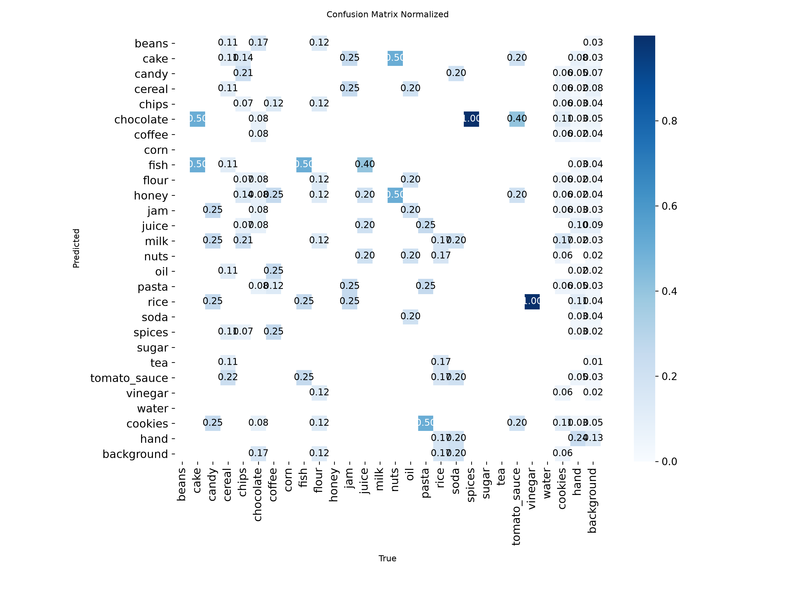
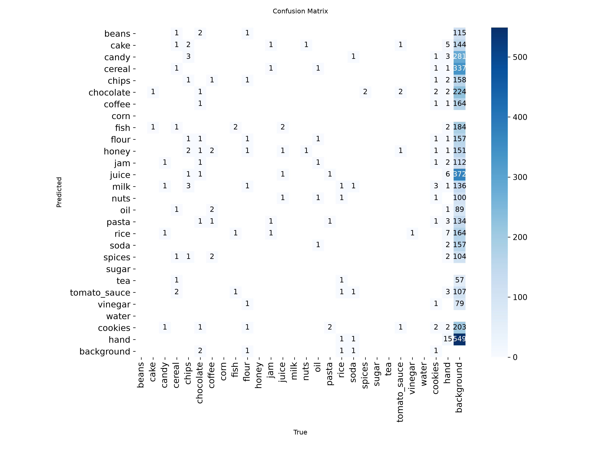

# Evaluation: p6k_hands_only_on_products6k_hands_v2 (2026-10-28)

- Weights: `models/p6k_hands_only/best.pt`
- Data: `data/products6k_hands_v2/data.yaml`, split `test` (142 images, 180 labeled boxes)
- imgsz 320, stage A

## Dataset split

- split.json not found; split unknown.

## Summary

| metric | value | target / baseline | status |
|---|---|---|---|
| mAP50 | 0.7525 | GrocerEye 0.8459 | below baseline (-9.34 pts) |
| mAP50 (NFR-5) | 0.7525 | >= 0.85 | FAIL |
| mAP50-95 | 0.7312 | - | - |

GrocerEye's 84.59% is Darknet mAP@0.5 on its own (unpublished) random 20% test split, so the comparison is approximate.

## Per-class results

Ultralytics P/R are at the max-F1 confidence; operating-point P/R are at conf 0.50, IoU >= 0.5.

| class | images | boxes | AP50 | AP50-95 | P (val) | R (val) | P @op | R @op | TP | FP | FN |
|---|---|---|---|---|---|---|---|---|---|---|---|
| cake | 2 | 2 | 0.995 | 0.995 | 0.470 | 1.000 | 0.667 | 1.000 | 2 | 1 | 0 |
| candy | 4 | 4 | 0.626 | 0.626 | 1.000 | 0.270 | 1.000 | 0.250 | 1 | 0 | 3 |
| cereal | 9 | 9 | 0.995 | 0.983 | 0.867 | 1.000 | 0.900 | 1.000 | 9 | 1 | 0 |
| chips | 14 | 14 | 0.889 | 0.867 | 0.795 | 0.833 | 0.857 | 0.857 | 12 | 2 | 2 |
| chocolate | 12 | 12 | 0.683 | 0.682 | 0.888 | 0.663 | 0.889 | 0.667 | 8 | 1 | 4 |
| coffee | 8 | 8 | 0.995 | 0.995 | 0.849 | 1.000 | 0.889 | 1.000 | 8 | 1 | 0 |
| fish | 4 | 4 | 0.652 | 0.568 | 0.697 | 0.500 | 0.667 | 0.500 | 2 | 1 | 2 |
| flour | 8 | 8 | 0.717 | 0.717 | 0.759 | 0.789 | 0.667 | 0.500 | 4 | 2 | 4 |
| jam | 4 | 4 | 0.995 | 0.995 | 0.866 | 1.000 | 0.800 | 1.000 | 4 | 1 | 0 |
| juice | 5 | 5 | 0.928 | 0.902 | 1.000 | 0.481 | 0.750 | 0.600 | 3 | 1 | 2 |
| nuts | 2 | 2 | 0.995 | 0.995 | 0.772 | 1.000 | 1.000 | 1.000 | 2 | 0 | 0 |
| oil | 5 | 5 | 0.582 | 0.582 | 0.929 | 0.400 | 1.000 | 0.200 | 1 | 0 | 4 |
| pasta | 4 | 4 | 0.509 | 0.481 | 0.657 | 0.500 | 1.000 | 0.500 | 2 | 0 | 2 |
| rice | 6 | 6 | 0.501 | 0.501 | 0.828 | 0.500 | 0.750 | 0.500 | 3 | 1 | 3 |
| soda | 5 | 5 | 0.007 | 0.006 | 0.000 | 0.000 | 0.000 | 0.000 | 0 | 3 | 5 |
| spices | 2 | 2 | 0.995 | 0.895 | 0.876 | 1.000 | 1.000 | 1.000 | 2 | 0 | 0 |
| tomato_sauce | 5 | 5 | 0.395 | 0.395 | 0.810 | 0.400 | 1.000 | 0.400 | 2 | 0 | 3 |
| vinegar | 1 | 1 | 0.995 | 0.995 | 0.638 | 1.000 | 1.000 | 1.000 | 1 | 0 | 0 |
| cookies | 18 | 18 | 0.636 | 0.633 | 0.905 | 0.528 | 0.900 | 0.500 | 9 | 1 | 9 |
| hand | 60 | 62 | 0.962 | 0.813 | 0.951 | 0.946 | 0.983 | 0.952 | 59 | 1 | 3 |

## Confusion matrix (conf 0.50, IoU >= 0.5, rows = true class)

| true \ pred | beans | cake | candy | cereal | chips | chocolate | coffee | corn | fish | flour | honey | jam | juice | milk | nuts | oil | pasta | rice | soda | spices | sugar | tea | tomato_sauce | vinegar | water | cookies | hand | background |
|---|---|---|---|---|---|---|---|---|---|---|---|---|---|---|---|---|---|---|---|---|---|---|---|---|---|---|---|---|
| beans | . | . | . | . | . | . | . | . | . | . | . | . | . | . | . | . | . | . | . | . | . | . | . | . | . | . | . | . |
| cake | . | **2** | . | . | . | . | . | . | . | . | . | . | . | . | . | . | . | . | . | . | . | . | . | . | . | . | . | . |
| candy | . | . | **1** | . | 2 | . | . | . | . | . | . | . | . | . | . | . | . | . | . | . | . | . | . | . | . | 1 | . | . |
| cereal | . | . | . | **9** | . | . | . | . | . | . | . | . | . | . | . | . | . | . | . | . | . | . | . | . | . | . | . | . |
| chips | . | . | . | . | **12** | . | . | . | . | . | . | . | . | . | . | . | . | . | . | . | . | . | . | . | . | . | . | 2 |
| chocolate | . | . | . | . | . | **8** | . | . | . | . | . | . | . | . | . | . | . | . | . | . | . | . | . | . | . | . | . | 4 |
| coffee | . | . | . | . | . | . | **8** | . | . | . | . | . | . | . | . | . | . | . | . | . | . | . | . | . | . | . | . | . |
| corn | . | . | . | . | . | . | . | . | . | . | . | . | . | . | . | . | . | . | . | . | . | . | . | . | . | . | . | . |
| fish | . | . | . | . | . | . | . | . | **2** | . | . | . | . | . | . | . | . | . | . | . | . | . | . | . | . | . | . | 2 |
| flour | . | . | . | . | . | . | . | . | . | **4** | . | . | . | . | . | . | . | 1 | . | . | . | . | . | . | . | . | . | 3 |
| honey | . | . | . | . | . | . | . | . | . | . | . | . | . | . | . | . | . | . | . | . | . | . | . | . | . | . | . | . |
| jam | . | . | . | . | . | . | . | . | . | . | . | **4** | . | . | . | . | . | . | . | . | . | . | . | . | . | . | . | . |
| juice | . | . | . | . | . | . | . | . | . | 1 | . | . | **3** | . | . | . | . | . | 1 | . | . | . | . | . | . | . | . | . |
| milk | . | . | . | . | . | . | . | . | . | . | . | . | . | . | . | . | . | . | . | . | . | . | . | . | . | . | . | . |
| nuts | . | . | . | . | . | . | . | . | . | . | . | . | . | . | **2** | . | . | . | . | . | . | . | . | . | . | . | . | . |
| oil | . | . | . | . | . | . | . | . | . | . | . | . | . | . | . | **1** | . | . | 2 | . | . | . | . | . | . | . | . | 2 |
| pasta | . | . | . | . | . | . | . | . | . | . | . | . | . | . | . | . | **2** | . | . | . | . | . | . | . | . | . | . | 2 |
| rice | . | . | . | . | . | . | . | . | . | 1 | . | . | . | . | . | . | . | **3** | . | . | . | . | . | . | . | . | . | 2 |
| soda | . | . | . | . | . | . | . | . | . | . | . | . | 1 | . | . | . | . | . | . | . | . | . | . | . | . | . | . | 4 |
| spices | . | . | . | . | . | . | . | . | . | . | . | . | . | . | . | . | . | . | . | **2** | . | . | . | . | . | . | . | . |
| sugar | . | . | . | . | . | . | . | . | . | . | . | . | . | . | . | . | . | . | . | . | . | . | . | . | . | . | . | . |
| tea | . | . | . | . | . | . | . | . | . | . | . | . | . | . | . | . | . | . | . | . | . | . | . | . | . | . | . | . |
| tomato_sauce | . | . | . | . | . | . | . | . | . | . | . | . | . | . | . | . | . | . | . | . | . | . | **2** | . | . | . | . | 3 |
| vinegar | . | . | . | . | . | . | . | . | . | . | . | . | . | . | . | . | . | . | . | . | . | . | . | **1** | . | . | . | . |
| water | . | . | . | . | . | . | . | . | . | . | . | . | . | . | . | . | . | . | . | . | . | . | . | . | . | . | . | . |
| cookies | . | 1 | . | . | . | . | . | . | . | . | . | 1 | . | . | . | . | . | . | . | . | . | . | . | . | . | **9** | . | 7 |
| hand | . | . | . | . | . | . | . | . | . | . | . | . | . | . | . | . | . | . | . | . | . | . | . | . | . | . | **59** | 3 |
| background | . | . | . | 1 | . | 1 | 1 | . | 1 | . | . | . | . | . | . | . | . | . | . | . | . | . | . | . | . | . | 1 | . |

Ultralytics confusion-matrix PNGs are computed at its val conf (0.001), so they show more low-confidence detections than the table above.

## Speed (ms per image, this machine)

preprocess 0.7, inference 3.6, loss 0.0, postprocess 1.7
